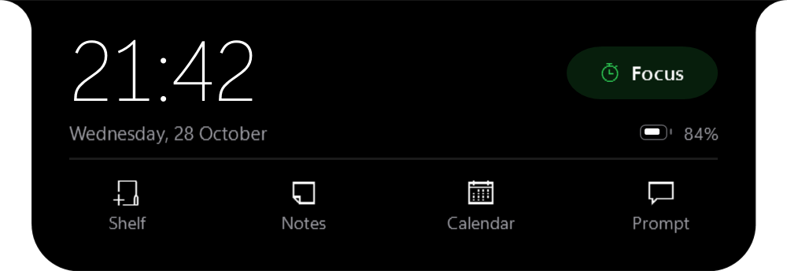
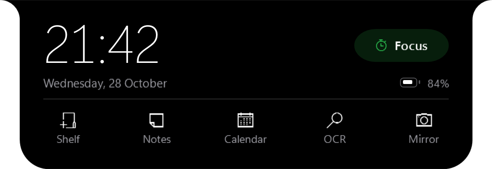
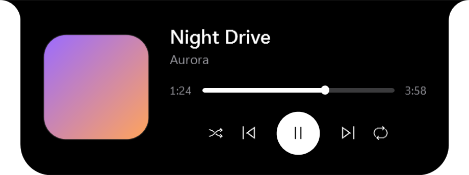
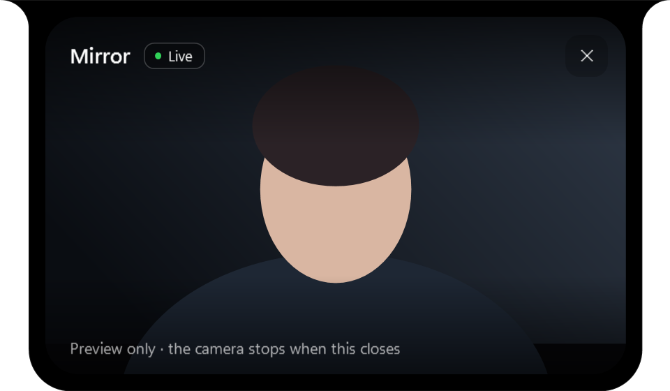
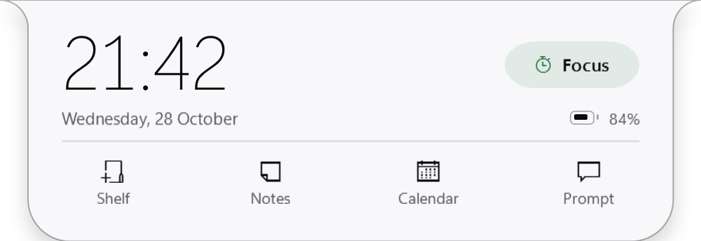
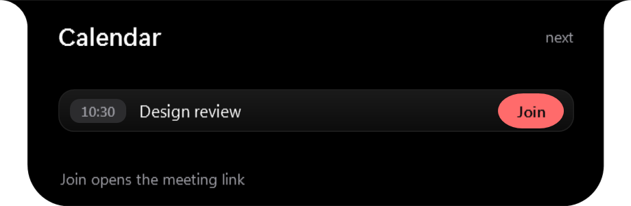
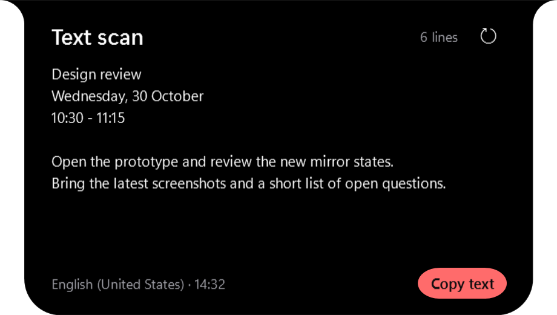

# Tolk Island

Tolk Island is a Windows overlay built with .NET 8 and WPF. It sits at the top center of the screen, stays above other windows, and expands into small panels for media, focus, notifications, the next calendar event, files, notes and text scans. The window is click-through outside the island shape.

<p align="center">
  
</p>

## Features

- **Media**: shows the current Windows media session with album art, title, progress, and play/pause, skip, shuffle and repeat controls. Compact mode uses a small waveform.
- **Focus timer**: 15, 25 or 50 minute timer with pause, reset and a completion card.
- **Notifications**: displays Windows toast notifications through `UserNotificationListener`. Cards are queued so a burst does not lose messages.
- **HUDs**: short volume, brightness and charging overlays.
- **Calendar**: reads the Windows appointment store and shows the next event with its join link.
- **File shelf**: holds file paths for dragging into another app. It does not copy or upload files.
- **Notes**: a small local list with transactional saves.
- **Text scan**: captures the current screen, runs Windows OCR on the image and shows the text with a copy button. The island hides during the capture so its own text is not included.
- **Mirror** (off by default): front-camera preview with a mirrored image, starting and permission states, and capture that stops as soon as the panel closes.
- **Downloads**: reports progress and completion for files in the Downloads folder.
- **Local API**: optional loopback HTTP API for scripts. See [docs/LOCAL_API.md](docs/LOCAL_API.md).

The data comes from Windows APIs (SMTC, toast listener, Core Audio, `GetSystemPowerStatus`, `AppointmentManager`, `FileSystemWatcher`). There are no placeholder values.

## Screens

| Idle home | Now playing | Mirror |
| --- | --- | --- |
|  |  |  |
|  |  |  |

The full set of states is in [demo/screens](demo/screens).

## Requirements

- Windows 10 version 2004 or newer, or Windows 11.
- .NET 8 SDK for building. The published executable is self-contained.

## Build and run

```powershell
dotnet build TolkIsland.csproj -c Release
dotnet run --project TolkIsland.csproj
```

To create a single-file release build:

```powershell
.\tools\publish.ps1
```

The script writes `dist\TolkIsland.exe`. Settings, notes and logs stay in `%LOCALAPPDATA%\TolkIsland`.

## Settings

The tray menu has four commands: show or hide the island, pause it, open Settings, and exit. Settings covers startup, placement, appearance, activities, the local API and update checks.

Settings are stored as JSON in `%LOCALAPPDATA%\TolkIsland\settings.json`. A corrupt file is moved aside and the last good backup is used.

## Privacy

- The app has no account, analytics endpoint or telemetry. Notes, settings and logs stay on the machine.
- The local API binds to `127.0.0.1` and requires an access token for every route except `/health`.
- Text scan runs through the local Windows OCR engine. Captured pixels are processed in memory and are not written or uploaded.
- Mirror never records. Frames are painted into the panel and released. Capture stops when the panel closes, the island hides or the session locks.
- The camera is governed by Windows camera privacy settings. If access is denied, the panel links to the relevant Windows setting.

## Project layout

- `MainWindow` contains the fixed host window and the shell that changes size between states.
- `Services` contains the Windows integrations: media, notifications, audio, brightness, focus, calendar, shelf, notes, OCR, downloads, update checks, the local API and the camera.
- `SettingsWindow`, `TrayMenuWindow` and `MessageWindow` are the supporting surfaces.
- `Native` contains the small P/Invoke and animation helpers.
- `tests/TolkIsland.Regression` is the regression suite and the offscreen renderer.

## Tests

```powershell
dotnet run --project tests/TolkIsland.Regression -c Debug
```

The suite covers settings and notes recovery, media timing, update checks, the local API, diagnostics and source-level UI checks. It exits non-zero on failure. CI runs on Windows for each push to `main`.

To regenerate the screenshots:

```powershell
dotnet run --project tests/TolkIsland.Regression -c Debug -- --render-screens demo/screens
```

## Licence

MIT. See [LICENSE](LICENSE).
